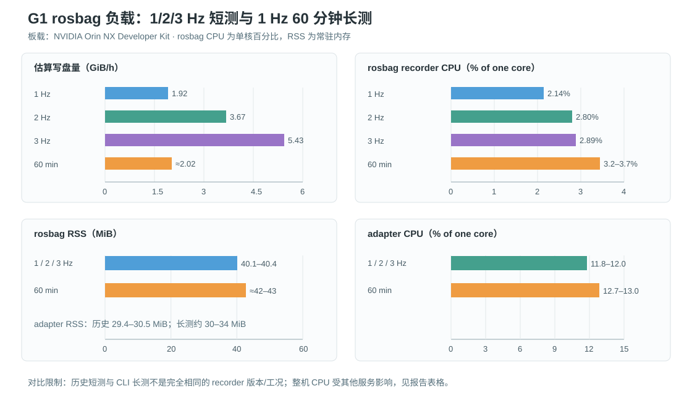

# RobotLogger Recorder

当前版本：**v1.0**。

订阅 adapter 发布的 ROS 2 消息，使用 ROS 2 自带 `ros2 bag record` 写入 rosbag2。

- [消息规范](recordlist.md)
- [数据说明模板](templates/data_description.md)：填写后放在 adapter 目录，随 bag 交付。

## 目录

```text
robotlogger-recorder/
├── README.md
├── recordlist.md
├── interfaces/
│   └── robotlogger_interfaces/   # 状态消息接口
├── templates/
│   └── data_description.md
├── deployment/
│   ├── robotlogger.sh
│   └── topics.regex
└── tools/
    └── audit_bag.py
```

请保留目录结构，脚本按相对路径读取白名单并调用录制、审计工具。

## 环境要求

- Linux 机器人，安装与系统和 CPU 架构匹配的 ROS 2、rosbag2 和 colcon。
- 安装与 ROS 2 发行版匹配的 `rosbag2` CLI 和存储插件。
- `audit` 的消息头时间戳分析需要 Python 3 可导入 `rclpy` 和 `rosidl_runtime_py`。
- adapter 按 [recordlist.md](recordlist.md) 发布消息，状态接口需在机器人使用的 ROS 2 环境中编译。
- 使用挂载盘时须提前挂载；保存目录没有写权限时，脚本会提示使用 sudo。

## 编译接口

加载对应 ROS 2 环境后，在仓库根目录编译状态接口：

```bash
source /opt/ros/jazzy/setup.bash  # 使用其他 ROS 2 发行版时替换 jazzy
colcon build --base-paths interfaces --packages-select robotlogger_interfaces
source install/setup.bash
```

## 录制

在仓库根目录运行，按提示填写挂载地址和保存目录：

```bash
deployment/robotlogger.sh record
```

保存到本机目录：

```bash
deployment/robotlogger.sh record --data /保存目录
```

脚本会发现 ROS 2 安装和可用的 RMW，并检查保存目录及剩余空间。首次运行按提示确认 ROS_DOMAIN_ID、挂载地址和保存目录，例如 `/mnt/robot-ssd`、`/mnt/robot-ssd/rosbags`。工具本身可放在其他目录。配置保存在 `~/.config/robotlogger/robotlogger.conf`，下次复用，也可编辑配置或通过命令行参数覆盖。

脚本用 ROS graph 检查启动时已发布的话题和消息类型，然后将合同固定话题以及已配置的点云/图像 topic 名称传给 `ros2 bag record`。固定名称可以在录制启动后再出现，topic publisher 暂停后恢复也会继续写入。点云和图像含设备 ID；如果 publisher 尚未启动且 topic 名称未知，首次运行时输入其名称，脚本会保存供下次使用。ROS Foxy 的 `rosbag2` CLI 不提供 topic 正则过滤，因此无法在录制开始后自动纳入任意未知 ID 的新 topic。

接口默认加载 `install/setup.bash`，其他工作空间用 `--workspace /路径/install/setup.bash` 指定。参数见 `deployment/robotlogger.sh --help`。

`ros2 bag record` 会记录收到的每一条消息，不会在 recorder 内做 20 Hz/1 Hz 抽样。adapter 应按 `recordlist.md` 的目标频率发布；若来源频率更高，adapter 应在独立进程中限频。无新消息时不会重复写入。bag 保存到 `<保存目录>/<机器人标识>/<YYYY_MMDD_HH_MM>/`；bag 时间为写入时间，消息中的采样时间保持不变。

启动时已发布 topic 若类型与合同不符，脚本会警告并跳过该名称。迟启动 topic 的类型只能在 bag 结束后由 `audit` 检出；Foxy CLI 不支持按 topic 类型动态过滤，adapter 必须遵守合同类型。

## 查看与审计

```bash
deployment/robotlogger.sh info /path/to/bag
deployment/robotlogger.sh audit /path/to/bag
```

审计仅支持 SQLite `.db3`，检查完整性、频率、消息间隔和时间戳；抽样跳过的 sequence 不代表传输丢包。其他存储插件生成的格式（如 MCAP）不支持使用当前 `audit` 工具审计。

已有 `ros2 bag record` 进程时会拒绝启动新的录制，即使该进程录制的是其他话题。已有自用录包程序的队伍，请提前检查兼容性，避免进程冲突。

## 测试与参赛说明

以下为基于 G1 本体的测试结果，供选手参考：



选手需自行编写 adapter，并测试、调整其 CPU、内存等资源占用。组委会将提供三星 T7 Shield 1TB 移动固态硬盘作为挂载存储选项，选手可自行选择将数据保存在本机或挂载盘上。

请选手们尽早完成测试与调整，如有问题可联系组委会。
